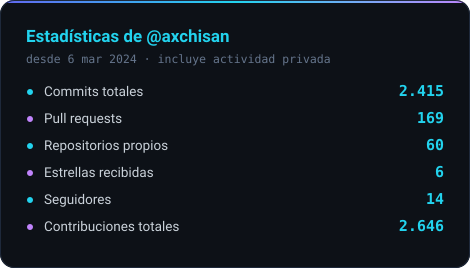
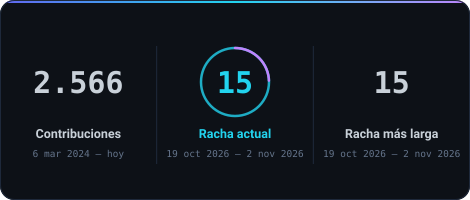

<picture>
  <source media="(prefers-color-scheme: dark)" srcset="./assets/banner-dark.svg">
  <source media="(prefers-color-scheme: light)" srcset="./assets/banner-light.svg">
  
</picture>

<p align="center">
  <a href="https://axchisan.com"></a>
  <a href="https://www.linkedin.com/in/duvan-arciniegas"></a>
  <a href="mailto:axchisan923@gmail.com"></a>
  
</p>

---

<table>
<tr>
<td width="140" align="center">
  <a href="https://github.com/axchisan/lost-and-prompt"></a>
</td>
<td>

### [Lost & Prompt](https://github.com/axchisan/lost-and-prompt) — mi proyecto principal

Todas tus sesiones de **Claude Code**, de todas tus carpetas, en un solo lugar: búscalas por lo que
se dijo en ellas, reanúdalas en tu terminal con un clic y organízalas. Gratis y de código abierto
para **macOS, Windows y Linux**.

`SwiftUI` `Rust` `Tauri` `React` · actualizaciones automáticas firmadas · Homebrew y Scoop

<a href="https://github.com/axchisan/lost-and-prompt/releases/latest"></a>
<a href="https://github.com/axchisan/lost-and-prompt/releases"></a>
<a href="https://lostandprompt.axchisan.com"></a>

</td>
</tr>
</table>

---

## Sobre mí

Desarrollador de software **autodidacta**, tecnólogo en Análisis y Desarrollo de Software (SENA).
Llevo más de **3 años construyendo producto**: primero como freelance para clientes reales, hoy también en equipo dentro de la industria.

No me caso con un stack. Me interesa el problema: si hay que levantar un microservicio en **Spring Boot**, una app en **Flutter**, un frontend en **Next.js** o un worker de render en **Python**, se hace bien y se despliega.

```yaml
rol:        Desarrollador de Software · Full-Stack
enfoque:    Apps multiplataforma · Backend · Automatización e IA
actualidad: desarrollador Flutter full stack en Migozz (migozz.com) — Flutter, Firebase, Google Cloud, FastAPI
antes:      microservicios Java/Spring Boot sobre AWS para un core asegurador (Linktic)
paralelo:   producto propio — juegos educativos, workers de medios, herramientas internas
ubicacion:  Bogotá, Colombia 🇨🇴
idiomas:    [Español (nativo), Inglés (B1)]
marca:      Axchi
```

- 🎯 Me muevo cómodo en **todo el ciclo**: modelo de datos → API → interfaz → despliegue.
- 🧩 Me gusta lo que **queda funcionando en producción**, no la demo bonita.
- 🎮 Debilidad confesa: **desarrollo de videojuegos** y programación creativa.
- 🤖 Integro **agentes de IA** y automatizaciones en flujos reales de trabajo, no como adorno.

---

## Stack

**Backend**

<p>
  
  
  
  
  
  
</p>

**Frontend & Mobile**

<p>
  
  
  
  
  
  
</p>

**Datos & Infraestructura**

<p>
  
  
  
  
  
  
  
  
</p>

**Herramientas**

<p>
  
  
  
  
  
  
</p>

---

## Estadísticas

<p align="center">
  <picture>
    <source media="(prefers-color-scheme: dark)" srcset="./assets/stats-dark.svg">
    <source media="(prefers-color-scheme: light)" srcset="./assets/stats-light.svg">
    
  </picture>
  <picture>
    <source media="(prefers-color-scheme: dark)" srcset="./assets/langs-dark.svg">
    <source media="(prefers-color-scheme: light)" srcset="./assets/langs-light.svg">
    
  </picture>
</p>

<p align="center">
  <picture>
    <source media="(prefers-color-scheme: dark)" srcset="./assets/streak-dark.svg">
    <source media="(prefers-color-scheme: light)" srcset="./assets/streak-light.svg">
    
  </picture>
</p>

<p align="center"><sub><i>Tarjetas generadas desde este mismo repositorio con GitHub Actions — sin depender de servicios de terceros. La de lenguajes ignora los repos donde se versionaron dependencias externas (<code>venv/</code>, <code>vendor/</code>), para que mida código escrito y no librerías descargadas.</i></sub></p>

---

## Proyectos destacados

**Producto y sistemas completos**

| Proyecto | Qué es | Stack |
|---|---|---|
| **[Calculadora de Gastos](https://github.com/axchisan/calculadora-gastos)** · [en vivo](https://gastos.axchisan.com) | Finanzas personales mes a mes: presupuesto, deudas, ahorro y transporte con festivos de Colombia. Web, Android y macOS sincronizados. | `Flutter` `Spring Boot 3` `AWS Lambda` `Terraform` `PostgreSQL` |
| **[Quanta](https://github.com/axchisan/quanta2)** | Juego educativo de Física y Química con IA generativa y multijugador en tiempo real. Monorepo Turborepo. | `Next.js 15` `Phaser 3` `Colyseus` `Supabase` |
| **Odontario** · *repositorio privado* | SaaS multi-tenant para consultorios odontológicos: agenda, pacientes, antecedentes clínicos y sitio público por clínica. Reescritura desde cero de un sistema que estuvo en producción. CI con cuatro flujos, pruebas de extremo a extremo y previsualización por rama. | `Next.js` `Drizzle` `Better Auth` `Sentry` `Playwright` |
| **[Gestión de Inventario SENA](https://github.com/axchisan/GestionInventarioSENA)** | Inventario de ambientes de formación: app móvil con escaneo QR, préstamos, mantenimientos y reportes. | `Flutter` `FastAPI` `PostgreSQL` |

**En producción para negocios reales**

| Proyecto | Qué es | Stack |
|---|---|---|
| **[axchisan.com](https://github.com/axchisan/axchisan.com)** · [en vivo](https://axchisan.com) | Mi estudio, Axchi: soluciones por sector con demos funcionando, precios a la vista y panel con CRM. | `Next.js 16` `Prisma` `Neon` `R2` `Resend` |
| **[Jabones Mari](https://github.com/axchisan/jabones-mari)** · [en vivo](https://jabonesmari.shop) | Tienda de jabones artesanales en Bogotá: catálogo administrable, carrito, pedidos por WhatsApp y notificaciones push. | `Next.js 16` `Drizzle` `Better Auth` |
| **[Magic H4nds](https://github.com/axchisan/magichands)** · [en vivo](https://magichands.axchisan.com) | Web y catálogo para un emprendimiento de crochet en Vélez, Santander. | `Next.js` `Tailwind` |
| **[Fudoshin Ryu](https://github.com/axchisan/Fudoshin-Ryu)** | Sitio oficial de un dojo de Shotokan Karate-Do afiliado a la JKA, con tres sedes en Santander. | `Next.js` `Tailwind` |

**Herramientas abiertas** — gratis, sin anuncios y para quien las necesite

| Proyecto | Qué es | Stack |
|---|---|---|
| **[Filtro de llamadas](https://github.com/axchisan/filtro-llamadas)** | Bloquea llamadas spam en Android sin anuncios, sin cuentas y sin internet. | `Kotlin` `Android` |
| **[Desliza](https://github.com/axchisan/desliza)** | Limpia la galería del celular deslizando como en Tinder. Nada sale del teléfono. | `Kotlin` `Compose` |
| **[Conseguir empleo](https://github.com/axchisan/conseguir-empleo)** | Kit para buscar trabajo con Claude Code: ofertas, hoja de vida adaptada y seguimiento de postulaciones. | `Python` `Claude Code` |
| **[Spotify Voice DJ](https://github.com/axchisan/spotify-voice-dj)** | DJ por voz para Spotify en macOS con un modelo local. Sin nube. | `Swift` `Python` `LM Studio` |

**Automatización e IA**

| Proyecto | Qué es | Stack |
|---|---|---|
| **[Bitácoras SENA](https://github.com/axchisan/bitacoras-sena)** | Lee work items de Azure DevOps, redacta con IA y genera el Excel oficial de etapa productiva. | `FastAPI` `React` `Azure DevOps API` |
| **[Tecnobichos](https://github.com/axchisan/tecnobichos)** + **[media-worker](https://github.com/axchisan/media-worker)** | Canal de shorts tech automatizado: guion, voz, render vertical con subtítulos karaoke y publicación en YouTube e Instagram. | `n8n` `FFmpeg` `edge-tts` `Docker` |

<sub>El resto de la pestaña <a href="https://github.com/axchisan?tab=repositories">repositories</a> es mi trayectoria: desde el primer CRUD en Java y los proyectos PHP del SENA hasta lo de hoy. Lo dejo a la vista a propósito.</sub>

---

## Ahora mismo

```text
▸ Construyendo   Lost & Prompt — llevándolo a winget, AUR y Flathub
▸ En paralelo    Odontario — SaaS para consultorios odontológicos
▸ Aprendiendo    arquitectura de microservicios, observabilidad y AWS
▸ Explorando     agentes de IA aplicados a flujos de trabajo reales
▸ Abierto a      colaboraciones, freelance y proyectos con propósito
```

---

<details>
<summary><b>Cómo está hecho este perfil</b></summary>

<br>

Las tarjetas de arriba no vienen de ningún servicio externo: las genera
[`scripts/generate-stats.mjs`](./scripts/generate-stats.mjs), un script de Node sin dependencias que
consulta la API GraphQL de GitHub y escribe los SVG en `assets/`. Un
[workflow](./.github/workflows/stats.yml) lo ejecuta dos veces al día y commitea el resultado.

Lo hice así por tres razones:

1. **No se cae.** Las instancias públicas de los generadores de tarjetas viven en rate limit y dejan
   miles de perfiles con imágenes rotas.
2. **Los números son honestos.** El reparto de lenguajes de GitHub cuenta los megabytes de
   dependencias que alguien versionó por error. Aquí esos repos se excluyen explícitamente.
3. **Nada queda invisible.** Los SVG no usan `opacity: 0` esperando una animación: la app móvil y los
   lectores con *reduced motion* no la ejecutan y la tarjeta saldría en blanco.

</details>

---

<p align="center">
  <b>¿Tienes una idea? Hablemos.</b><br>
  <a href="https://axchisan.com">axchisan.com</a> ·
  <a href="mailto:axchisan923@gmail.com">axchisan923@gmail.com</a> ·
  <a href="https://www.linkedin.com/in/duvan-arciniegas">LinkedIn</a>
</p>

<p align="center"><sub>Hecho con café ☕ desde Colombia</sub></p>
